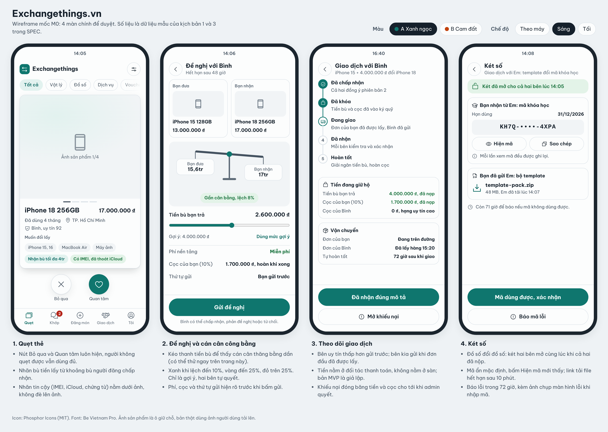

# Exchangethings.vn: sàn đổi đồ kiểu quẹt thẻ

Sàn đổi đồ trong nước: đăng món, quẹt như app hẹn hò, hai bên cùng thích thì khớp, thương lượng đổi ngang, đổi có bù tiền hoặc mua thẳng. Đổi được mọi thứ hợp pháp: hàng vật lý, file số, mã khóa học, voucher, dịch vụ, kiến thức.

**Trạng thái:** prompt dựng MVP đã xong (bản Việt và bản Anh, PromptGate **98/100**). Mốc **M0 đã được duyệt** ngày 22/11/2026, màu chủ đạo **A Xanh ngọc**. Tiếp theo: dựng M1 trong repo riêng.



## Lựa chọn của anh (22/11/2026)

| Hạng mục | Lựa chọn |
|---|---|
| Tên thương hiệu | Exchangethings.vn (thay cho "Keo.vn" vì chữ "kèo" gắn với cá cược) |
| Phí | Miễn phí giai đoạn đầu; cơ chế phí cài sẵn |
| Loại món | Mọi thứ hợp pháp: 5 loại chính + loại "khác" có kiểm duyệt |
| Giao hàng | Gặp trực tiếp và gửi qua vận chuyển |
| Tiền cọc | Theo điểm uy tín: mới 20%, thường 10%, uy tín cao 0% |
| Thanh toán | Ưu tiên PayOS (VietQR); MVP dùng giả lập |

## Thư mục này có gì

| File | Nội dung |
|---|---|
| `prompt-vi.txt`, `prompt-en.txt` | Prompt dựng MVP, đã cập nhật theo các lựa chọn trên |
| `scores.md` | Điểm PromptGate của hai bản prompt |
| `m0/SPEC.md` | Đặc tả: vai trò, 6 loại món, luồng, state machine, tiền, công thức ghép cặp và cán cân, điểm uy tín, phân quyền dữ liệu, mô hình dữ liệu, câu hỏi mở |
| `m0/PLAN.md` | 7 mốc kèm đầu ra, tiêu chí xong, ước lượng (khoảng 13-16 ngày cho M1-M6), việc anh cần chuẩn bị, rủi ro, chỉ số |
| `m0/DECISIONS.md` | 16 quyết định kèm lý do: 6 do anh chọn, 10 quyết định thiết kế |
| `m0/wireframes/index.html` | Wireframe 4 màn (quẹt, đề nghị với cán cân, theo dõi giao dịch, két số); đổi được màu A/B và sáng/tối; cán cân kéo thử được |
| `m0/wireframes/preview-a.png`, `preview-b.png` | Ảnh chụp hai phương án màu |

## M0 đã duyệt như thế nào

1. Màu chủ đạo: **A Xanh ngọc** (#0F766E).
2. SPEC: duyệt nguyên trạng, giữ đủ 6 loại món và 5 kịch bản.
3. Còn mở: 7 câu hỏi ở cuối SPEC (tên miền, pháp nhân, thời điểm thu phí, PayOS ký quỹ, vận chuyển, người kiểm duyệt, kênh hỗ trợ); không chặn M1.

## Sau khi duyệt: bắt đầu dựng

1. Tạo repo GitHub mới cho dự án (ví dụ `exchangethings-vn`).
2. Copy toàn bộ nội dung thư mục `m0/` vào gốc repo mới, giữ nguyên tên file.
3. Mở Claude Code tại repo đó, dán `prompt-vi.txt` (hoặc `prompt-en.txt`). Prompt có sẵn dòng: thấy PLAN.md, SPEC.md, DECISIONS.md và wireframes/ thì bỏ qua M0, làm từ M1.
4. Mỗi mốc mở một session mới, bắt đầu bằng: *"Đọc PLAN.md, SPEC.md, DECISIONS.md, làm tiếp mốc Mx"*.

Chấm lại điểm prompt sau khi sửa:
```bash
node OUTPUTS/claude-web-design-viktor-oddy/tools/score-prompts.js OUTPUTS/exchangethings-vn/prompt-vi.txt OUTPUTS/exchangethings-vn/prompt-en.txt --min 85 --write
```

## Đã kiểm tra gì

- Hai bản prompt: 98/100 trên engine PromptGate, không còn mục thiếu.
- Wireframe: chạy trên Chromium không lỗi console; không tràn ngang ở 390px và 1800px; font Be Vietnam Pro hiển thị đủ dấu.
- Cán cân: bù 0 ₫ lệch 24% (vàng), bù 2.600.000 ₫ lệch 8% (xanh), bù 4.000.000 ₫ cân bằng, khớp công thức ở SPEC mục 8.
- Tương phản màu: mọi cặp chữ/nền chính đạt WCAG AA (từ 4,5:1) ở cả hai phương án, cả sáng lẫn tối.

## Nguồn pháp lý đã kiểm chứng

- [Cải cách hành chính 2025: 34 tỉnh/thành, chính quyền 2 cấp](https://en.wikipedia.org/wiki/2025_Vietnamese_administrative_reform)
- [Thông tư 32/2013/TT-NHNN về hạn chế sử dụng ngoại hối](https://luatvietnam.vn/legal-updates/circular-no-32-2013-tt-nhnn-on-foreign-exchange-restrictions-remains-effective-892-115661-article.html)
- [Luật Bảo vệ dữ liệu cá nhân, hiệu lực 01/01/2026](https://vneconomy.vn/nhung-diem-moi-trong-luat-bao-ve-du-lieu-ca-nhan-tu-112026.htm)
- [Luật Thương mại điện tử 2025, số 122/2025/QH15](https://thuvienphapluat.vn/van-ban/Thuong-mai/Luat-Thuong-mai-dien-tu-2025-so-122-2025-QH15-662035.aspx)

Đây là tham khảo kỹ thuật, không thay cho tư vấn pháp lý.
