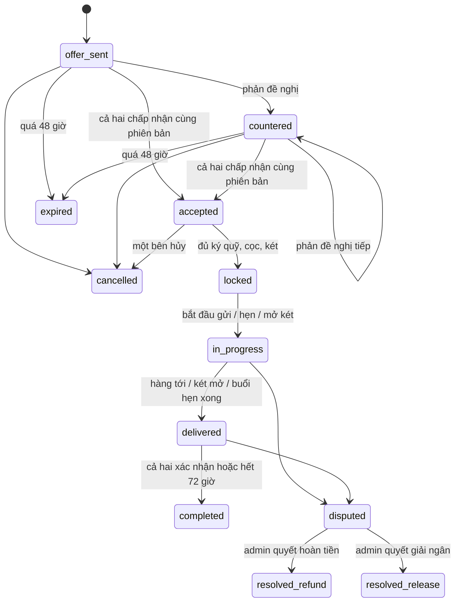

# SPEC · Exchangethings.vn (MVP)

> Trạng thái: **Đã duyệt** ngày 22/11/2026 (phiên bản 0.1). Các lựa chọn của chủ dự án và lý do kỹ thuật nằm ở `DECISIONS.md`; tiến độ ở `PLAN.md`; giao diện ở `wireframes/index.html`.

## 1. Tóm tắt

Exchangethings.vn là sàn đổi đồ trong nước. Người dùng đăng món mình có, quẹt món của người khác, hai bên cùng thích thì khớp, rồi thương lượng đổi: đổi ngang, đổi có bù tiền, hoặc mua thẳng. Đổi được mọi thứ hợp pháp: hàng vật lý, file số, mã khóa học, voucher, dịch vụ và kiến thức, và món khác đã qua kiểm duyệt.

## 2. Nguyên tắc

1. **Chỉ Việt Nam:** người dùng có số điện thoại +84, địa chỉ trong nước, mọi giá bằng VND.
2. **Không tự giữ tiền:** mọi khoản tiền (tiền bù, tiền mua, tiền cọc) đi qua đối tác trung gian thanh toán có ký quỹ.
3. **Không bên nào nhận trọn phần lợi trước khi bên kia cam kết:** thứ tự gửi hàng, ký quỹ và két số đều phục vụ nguyên tắc này.
4. **Miễn phí giai đoạn đầu:** phí 0%, nhưng cơ chế phí đã cài sẵn để bật khi cần.
5. **An toàn trước tăng trưởng:** món rủi ro (điện thoại, hàng hiệu, mã, loại "khác") có thêm bước bắt buộc.

## 3. Vai trò người dùng

| Vai trò | Điều kiện | Quyền chính |
|---|---|---|
| Khách | Chưa đăng nhập | Xem trang giới thiệu, xem thử thẻ món (mờ thông tin người đăng) |
| Thành viên mới | Đã đăng nhập, chưa xác minh SĐT **hoặc** dưới 3 giao dịch hoàn tất | Đăng món, quẹt, khớp, giao dịch tối đa 5.000.000 ₫ mỗi giao dịch; cọc 20% |
| Thành viên | Đã xác minh SĐT và từ 3 giao dịch hoàn tất | Không giới hạn giá trị; cọc 10% |
| Uy tín cao | Từ 20 giao dịch hoàn tất, điểm TB từ 4,8/5, không thua khiếu nại trong 90 ngày | Cọc 0%; huy hiệu "Uy tín cao" |
| Admin | Gán thủ công | Kiểm duyệt, xử lý khiếu nại, cấu hình |

Các ngưỡng trên nằm trong `platform_settings`, admin đổi được không cần sửa code.

## 4. Sáu loại món

| Loại | Ví dụ | Cách giao | Bắt buộc khi đăng | Rủi ro chính | Cách xử lý |
|---|---|---|---|---|---|
| Vật lý | iPhone, áo, giày | Vận chuyển hoặc gặp trực tiếp | Từ 3 ảnh; điện thoại: IMEI + cam kết thoát iCloud/Google; hàng hiệu: ảnh chứng từ | Gửi mà không nhận lại; hàng giả; máy khóa iCloud | Cọc theo uy tín, thứ tự gửi, chứng từ, khiếu nại có bằng chứng |
| File số | Template, e-book | Két số | Tích "Tôi có quyền chia sẻ" | Nội dung vi phạm bản quyền, mã độc | Danh sách định dạng cho phép, quét file (interface, mock), báo cáo |
| Mã khóa học | Mã kích hoạt khóa học online | Két số | Hạn dùng, tích "được phép chuyển nhượng" | Mã đã dùng, mã không chuyển nhượng được | Mở két theo luật, 72 giờ khiếu nại |
| Voucher, mã giảm giá | Voucher 500.000 ₫ | Két số | Hạn dùng, điều kiện áp dụng | Hết hạn, đã dùng | Như mã khóa học; cảnh báo khi còn dưới 7 ngày |
| Dịch vụ, kiến thức | 60 phút dạy tiếng Anh | Hẹn lịch qua chat | Thời lượng, hình thức (online/trực tiếp) | Không thực hiện, chất lượng tranh cãi | Xác nhận sau buổi hẹn, đánh giá hai chiều |
| Khác | Món hợp pháp không thuộc 5 loại trên | Tùy món | Mô tả rõ, chờ admin duyệt | Hàng cấm trá hình | Chỉ hiển thị sau khi duyệt |

Định dạng file cho phép trong MVP: pdf, png, jpg, webp, mp4, zip; tối đa 50 MB mỗi file.

## 5. Luồng chính

### 5.1 Đăng ký và xác minh
1. Đăng nhập bằng email (magic link) hoặc Google.
2. Hoàn thiện hồ sơ: tên hiển thị, ảnh, tỉnh/thành, phường/xã (34 tỉnh/thành, 2 cấp).
3. Xác minh số điện thoại +84 bằng OTP (SmsProvider, MVP là mock). Chưa xác minh vẫn dùng được nhưng thuộc nhóm "Thành viên mới".

### 5.2 Đăng món
1. Chọn loại → form hiện đúng trường bắt buộc của loại đó (bảng mục 4).
2. Nhập giá trị ước tính, "muốn đổi lấy" (danh mục, từ khóa hoặc món cụ thể), khoảng tiền bù chấp nhận (trả thêm tối đa / nhận thêm tối đa), có bán thẳng không.
3. Ảnh tải lên được xóa EXIF ở server trước khi lưu.
4. Lọc từ khóa cấm: khớp mức nặng thì chặn đăng; khớp mức nhẹ thì gắn cờ chờ duyệt. Loại "khác" luôn chờ duyệt.

### 5.3 Quẹt và khớp
1. Chồng thẻ ưu tiên theo điểm gợi ý (mục 8), lọc theo loại, danh mục, khoảng giá trị, tỉnh/thành, "chỉ món hợp với đồ tôi có".
2. Quẹt phải hoặc bấm nút trái tim là quan tâm; quẹt trái hoặc nút X là bỏ qua. Bàn phím: mũi tên phải/trái.
3. Khớp khi A thích một món của B và B thích một món bất kỳ của A. Tạo `matches`, mở chat, hiệu ứng "Khớp rồi!".
4. Không cần khớp vẫn gửi đề nghị trực tiếp được.

### 5.4 Đề nghị và phản đề nghị
1. Màn đề nghị gồm cột "Tôi đưa", cột "Tôi nhận", thanh tiền bù, cán cân công bằng, dòng phí, dòng cọc dự kiến.
2. Mỗi lần gửi tạo một `offer_versions` mới; phiên bản cũ chỉ đọc.
3. Bên nhận đề nghị có ba lựa chọn: chấp nhận, phản đề nghị (sửa món hoặc tiền bù), từ chối.
4. Hết hạn sau 48 giờ kể từ phiên bản mới nhất; nhắc trước 12 giờ.
5. Chỉ thành giao dịch khi cả hai chấp nhận **cùng một phiên bản**. Khoảng tiền bù trong hồ sơ món là gợi ý cho việc ghép cặp, không chặn hai bên tự thỏa thuận mức khác.

### 5.5 Thực hiện giao dịch theo loại

| Kiểu | Điều kiện để khóa (locked) | Thực hiện | Mở két / xác nhận | Hoàn tất |
|---|---|---|---|---|
| Vận chuyển (vật lý ↔ vật lý) | Tiền bù vào ký quỹ; cọc của từng bên đã nạp | Bên uy tín thấp hơn gửi trước; bên kia gửi khi đơn đầu "đã lấy hàng" | Mỗi bên bấm "Đã nhận đúng mô tả" | Cả hai xác nhận, hoặc 72 giờ sau khi đơn cuối báo giao mà không khiếu nại |
| Gặp trực tiếp | Tiền bù (nếu có) vào ký quỹ | Hẹn điểm công cộng, checklist kiểm tra | Mỗi bên bấm "Đã gặp và nhận đủ" | Cả hai xác nhận |
| Số ↔ số | Cả hai nộp mã/file vào két; tiền bù vào ký quỹ | Hệ thống mở két hai bên cùng lúc | Mỗi bên kiểm tra mã/file | Cả hai xác nhận, hoặc 72 giờ sau khi mở két |
| Lai (số ↔ vật lý) | Bên số nộp vào két; cọc của bên vật lý; tiền bù vào ký quỹ | Bên vật lý gửi trước | Két mở khi đơn báo giao thành công hoặc người nhận xác nhận | Như vận chuyển |
| Dịch vụ | Tiền bù (nếu có) vào ký quỹ | Hẹn lịch qua chat | Mỗi bên xác nhận sau buổi mình được nhận | Cả hai xác nhận |
| Mua thẳng | Người mua nạp đủ tiền vào ký quỹ; người bán nộp mã/file (nếu là đồ số) | Đồ số: két mở ngay khi đủ; vật lý: người bán gửi hàng | Người mua xác nhận | Người mua xác nhận, hoặc 72 giờ sau khi giao/mở két |

Thứ tự gửi khi hai bên bằng điểm uy tín: bên nhận món giá trị cao hơn gửi trước.

## 6. State machine giao dịch

| Từ | Sang | Ai kích hoạt | Điều kiện | Tác động |
|---|---|---|---|---|
| offer_sent / countered | countered | Bên nhận đề nghị | Đề nghị chưa hết hạn | Tạo phiên bản mới, reset hạn 48 giờ |
| offer_sent / countered | accepted | Bên còn lại chấp nhận | Cùng phiên bản; cả hai trong giới hạn giá trị | Đặt trạng thái món "đang giữ chỗ" |
| offer_sent / countered | expired | Hệ thống | Quá 48 giờ | Thông báo hai bên |
| offer_sent / countered / accepted | cancelled | Một trong hai bên | Chưa locked | Bỏ giữ chỗ món |
| accepted | locked | Hệ thống | Đủ các phần ở mục 5.5 | Hiện địa chỉ và SĐT cho đối phương, bỏ che trong chat |
| locked | in_progress | Hệ thống hoặc bên gửi | Có vận đơn / mở két / tới giờ hẹn | Ghi `transaction_events` |
| in_progress | delivered | Hệ thống hoặc bên nhận | Vận đơn báo giao / két mở / xác nhận buổi hẹn | Bắt đầu đếm 72 giờ |
| delivered | completed | Cả hai bên hoặc hệ thống | Cả hai xác nhận hoặc hết 72 giờ không khiếu nại | Giải ngân ký quỹ, hoàn cọc, mở đánh giá |
| in_progress / delivered | disputed | Một trong hai bên | Còn trong 72 giờ, kèm bằng chứng | Đóng băng ký quỹ và cọc |
| disputed | resolved_refund / resolved_release | Admin | Đã xem bằng chứng hai bên | Hoàn hoặc giải ngân, cập nhật uy tín |

Mọi chuyển trạng thái khác bị server từ chối và ghi log. `transaction_events` chỉ được thêm, không sửa, không xóa.

## 7. Tiền: ký quỹ, cọc, phí

| Khoản | Ai trả | Khi nào trả | Khi nào trả lại / giải ngân |
|---|---|---|---|
| Tiền bù | Bên được thỏa thuận | Trước locked | Giải ngân cho bên kia khi completed hoặc resolved_release; hoàn khi resolved_refund |
| Tiền mua thẳng | Người mua | Trước locked | Như tiền bù |
| Tiền cọc (chỉ kiểu vận chuyển, lai) | Mỗi bên, theo hạng uy tín: 20% / 10% / 0% giá trị món mình nhận | Trước locked | Hoàn khi completed; khi thua khiếu nại thì dùng để bồi hoàn bên kia |
| Phí nền tảng | Bên nhận tiền | Khấu trừ khi giải ngân | Giai đoạn đầu 0%, ghi "Miễn phí" |

**Ví dụ kịch bản 1 (số liệu mẫu do người dùng khai):**

| | An | Bình |
|---|---|---|
| Đưa | iPhone 15 128GB, khai 13.000.000 ₫ | iPhone 18 256GB, khai 17.000.000 ₫ |
| Tỉnh/thành | Đà Nẵng | TP. Hồ Chí Minh |
| Điểm uy tín | 74, hạng Thành viên | 92, hạng Uy tín cao |
| Tiền bù | Trả 4.000.000 ₫ (sau phản đề nghị) | Nhận 4.000.000 ₫ |
| Cọc | 10% × 17.000.000 = 1.700.000 ₫ | 0 ₫ |
| Thứ tự gửi | Gửi trước (điểm thấp hơn) | Gửi khi đơn của An đã được lấy |
| Khi hoàn tất | Được hoàn 1.700.000 ₫ | Nhận 4.000.000 ₫ (phí 0 ₫) |

## 8. Ghép cặp và cán cân

**Điểm gợi ý** (0 đến 1) cho một món M của người đăng O, xét với người xem V:

`score = 0,35 × wants_fit + 0,25 × value_balance + 0,20 × proximity + 0,20 × trust`

| Thành phần | Cách tính |
|---|---|
| wants_fit | Trung bình hai chiều: (M có khớp mong muốn của V không) và (món tốt nhất của V có khớp mong muốn của O không). Mỗi chiều: khớp món cụ thể = 1; khớp danh mục = 0,7; khớp từ khóa = 0,4; không khớp = 0 |
| value_balance | `1 − min(1, phần_lệch_còn_lại / max(giá_trị_hai_bên))`, trong đó phần lệch còn lại là chênh lệch giá trị sau khi trừ mức bù tối đa hai bên chấp nhận |
| proximity | Cùng tỉnh/thành = 1; cùng miền = 0,6; khác miền = 0,3; đồ số và dịch vụ online = 1 |
| trust | Điểm uy tín của O / 100 |

Ví dụ An xem iPhone 18 của Bình: wants_fit 0,85; value_balance 0,94 (An chịu bù tối đa 3 triệu, còn lệch 1 triệu trên 17 triệu); proximity 0,3 (Đà Nẵng và TP. Hồ Chí Minh khác miền); trust 0,92 → score ≈ 0,78.

**Cán cân công bằng** trên màn đề nghị:

- Độ lệch = `|giá trị nhận − giá trị đưa − tiền bù| / max(giá trị nhận, giá trị đưa)`.
- Xanh khi lệch đến 10% ("Gần cân bằng"); vàng khi lệch trên 10% đến 25% ("Lệch vừa"); đỏ khi trên 25% ("Lệch nhiều").
- Góc nghiêng cán cân tỉ lệ với độ lệch, tối đa 14 độ; bằng 0 khi cân bằng.
- Mức bù gợi ý = chênh lệch giá trị, làm tròn 100.000 ₫, giới hạn trong khoảng hai bên chấp nhận.
- Ví dụ An: bù 2.600.000 ₫ → lệch 8,2%, xanh, cân hơi nghiêng; gợi ý 4.000.000 ₫ → lệch 0%.

## 9. Điểm uy tín

`trust = 20 + 12 × (điểm_TB − 3) + 30 × tỉ_lệ_hoàn_tất + min(20, số_giao_dịch_hoàn_tất) − 25 × số_khiếu_nại_thua_90_ngày`, giới hạn 0 đến 100.

- Dưới 3 đánh giá: điểm TB tính là 3. Chưa có giao dịch: tỉ lệ hoàn tất tính là 0,5. Người mới vì thế có khoảng 35 điểm.
- Tỉ lệ hoàn tất = hoàn tất / (hoàn tất + hủy sau khi locked + khiếu nại thua).
- Trọng số nằm trong `platform_settings`, tinh chỉnh sau ra mắt.
- Hạng (mục 3) quyết định cọc và giới hạn; điểm dùng cho ghép cặp và thứ tự gửi.

## 10. Phân quyền dữ liệu (RLS)

| Dữ liệu | Chủ sở hữu | Người khác | Đối phương sau khớp | Đối phương sau locked | Admin |
|---|---|---|---|---|---|
| Thông tin công khai của món | Đọc, sửa | Đọc | Đọc | Đọc | Đọc, sửa |
| Ảnh chứng từ hàng hiệu | Đọc, sửa | Không | Đọc | Đọc | Đọc |
| IMEI | Đọc, sửa | 4 số cuối | 4 số cuối | Đầy đủ | Đầy đủ |
| Địa chỉ chính xác, SĐT | Đọc, sửa | Không | Không | Đọc | Đọc |
| Tin nhắn | Hai người trong match | Không | Đọc, viết | Đọc, viết | Chỉ khi có báo cáo hoặc khiếu nại |
| Nội dung két số | Viết, đọc của mình | Không | Không | Đọc khi đủ luật mở | Chỉ khi có khiếu nại, có ghi log |
| Đánh giá | Không sửa sau 24 giờ | Đọc | Đọc | Đọc | Đọc, ẩn |
| Khiếu nại | Người mở | Không | Không | Hai bên của giao dịch | Đọc, xử lý |
| platform_settings | Không | Không | Không | Không | Đọc, sửa |

Bắt buộc có test tự động chứng minh từng dòng "Không" ở bảng trên.

## 11. Mô hình dữ liệu (cột chính)

| Bảng | Cột chính |
|---|---|
| profiles | id, display_name, avatar_path, province_code, ward_code, trust_score, tier (new/regular/high), completed_swaps, rating_avg, rating_count, lost_disputes_90d, role (user/admin), locale, banned_at |
| profile_private | id, phone_e164, phone_verified_at, street_address. Chỉ chủ tài khoản và admin đọc được; mã hóa ở tầng ứng dụng từ M4 (DECISIONS D-18) |
| items | id, owner_id, type (physical/digital_file/course_code/voucher/service/other), category_id, title, description, condition, est_value_vnd, topup_pay_max_vnd, topup_receive_max_vnd, sell_price_vnd, delivery_methods, province_code, expires_on, imei_last4 (đồng bộ từ item_private), signed_out_confirmed, transfer_right_confirmed, duration_minutes, status (draft/pending_review/active/reserved/swapped/removed), review_note, requires_review |
| item_private | item_id, owner_id, imei_full. Chỉ chủ món và admin đọc được; mã hóa ở tầng ứng dụng từ M4 (DECISIONS D-18) |
| item_media | id, item_id, kind (photo/proof), storage_path, width, height, exif_stripped |
| item_wants | id, item_id, want_type (item/category/keyword), wanted_item_id, category_id, keyword |
| swipes | viewer_id, item_id, direction (like/pass), created_at; khóa chính (viewer_id, item_id) |
| matches | id, user_a, user_b, item_a, item_b, created_at |
| offers | id, match_id, from_user, to_user, current_version, status, expires_at |
| offer_versions | id, offer_id, version, author_id, topup_payer_id, topup_vnd, cash_only, created_at |
| offer_items | offer_version_id, item_id, side (give/get) |
| transactions | id, offer_version_id, kind (carrier/meetup/digital/mixed/service/purchase), status, ship_first_user_id, auto_complete_at |
| transaction_events | id, transaction_id, from_status, to_status, actor_id, reason, created_at (chỉ thêm) |
| escrow_payments | id, transaction_id, payer_id, payee_id, purpose (topup/purchase/deposit), amount_vnd, provider, provider_ref, status (pending/held/released/refunded/failed) |
| shipments | id, transaction_id, sender_id, carrier, tracking_code, status (created/picked_up/in_transit/delivered/returned) |
| vault_entries | id, transaction_id, owner_id, kind (code/file), ciphertext, file_path, revealed_at |
| vault_access_logs | id, vault_entry_id, viewer_id, viewed_at |
| messages | id, match_id, sender_id, body, image_path, masked, created_at |
| reviews | id, transaction_id, reviewer_id, reviewee_id, rating (1-5), comment |
| reports, disputes, blocks | báo cáo, khiếu nại kèm bằng chứng, chặn người dùng |
| notifications | id, user_id, type, payload, read_at |
| categories | id, parent_id, name_vi, name_en, requires_proof |
| banned_keywords | id, keyword, severity (block/flag) |
| platform_settings | key, value: fee_rate = 0; deposit_rates = {new 0,2; regular 0,1; high 0}; high_trust = {swaps 20; rating 4,8; lost_disputes_90d 0}; new_account_limit_vnd = 5.000.000; match_weights; offer_ttl_hours = 48; auto_complete_hours = 72; signed_url_ttl_seconds = 600 |

Ngoài danh sách tối thiểu trong prompt, SPEC thêm bảng `vault_access_logs` để ghi lại mỗi lần xem két.

## 12. Kiểm duyệt và chống gian lận

- Che SĐT, số tài khoản, link thanh toán ngoài trong chat cho tới khi locked.
- Giới hạn 5.000.000 ₫ mỗi giao dịch cho Thành viên mới.
- Giới hạn tần suất: tối đa 300 lượt quẹt, 30 đề nghị, 200 tin nhắn mỗi ngày mỗi tài khoản (cấu hình được).
- Món loại "khác" và món bị gắn cờ chờ duyệt; danh mục hàng hiệu bắt buộc chứng từ.
- Báo cáo người dùng và món; chặn người dùng thì ẩn hai chiều.
- Admin xử lý khiếu nại trong 48 giờ; mọi quyết định ghi lý do.

## 13. Thông báo (trong ứng dụng và email)

Khớp mới · đề nghị mới / phản đề nghị · đề nghị sắp hết hạn (trước 12 giờ) · giao dịch đã khóa · đối phương đã gửi hàng · két đã mở · hàng đã giao · còn 24 giờ trước khi tự hoàn tất · khiếu nại được mở / có kết quả · mời đánh giá.

## 14. Admin

Hàng chờ duyệt (món "khác", món bị gắn cờ) · báo cáo · khiếu nại (xem bằng chứng hai bên, ra quyết định) · khóa/mở tài khoản · danh mục · từ khóa cấm · cấu hình phí, cọc, ngưỡng, trọng số · nhật ký thao tác admin.

## 15. Yêu cầu phi chức năng

- Mobile-first: chuẩn ở 390px, đúng ở 1440px. PWA cài được.
- Lighthouse mobile (trang chủ, màn quẹt): Performance từ 85, Accessibility từ 95.
- Tôn trọng prefers-reduced-motion; mọi thao tác quẹt có nút và phím tắt tương đương.
- Song ngữ VI (mặc định) và EN; định dạng tiền `13.000.000 ₫`.
- Font Be Vietnam Pro qua next/font (hỗ trợ đầy đủ dấu tiếng Việt).
- Bảo mật: RLS mọi bảng; nội dung két mã hóa; signed URL 10 phút; không log nội dung két; không để key trong code.
- Riêng tư: xóa EXIF; chỉ lưu dữ liệu cá nhân cần thiết.

## 16. Pháp lý (bản nháp, cần luật sư duyệt)

- Điều khoản sử dụng.
- Chính sách quyền riêng tư theo Luật Bảo vệ dữ liệu cá nhân số 91/2025/QH15.
- Quy chế hoạt động sàn theo Luật Thương mại điện tử số 122/2025/QH15.
- Niêm yết và thanh toán bằng VND theo Thông tư 32/2013/TT-NHNN.
- Danh sách hàng cấm.

## 17. Ngoài phạm vi MVP

Thanh toán và vận chuyển thật (chỉ interface + mock) · eKYC bằng CCCD · đăng nhập Zalo · ứng dụng iOS/Android riêng · ước tính giá bằng AI · đấu giá · giao dịch quốc tế · dịch tự động trong chat.

## 18. Câu hỏi mở

1. Tên miền exchangethings.vn và nhãn hiệu đã được đăng ký cho anh chưa?
2. Pháp nhân nào đứng tên vận hành sàn?
3. Khi nào bắt đầu thu phí, mức bao nhiêu?
4. PayOS có cung cấp được ký quỹ cho mô hình sàn không, điều khoản ra sao?
5. Chọn đơn vị vận chuyển nào cho bản thật?
6. Ai trực kiểm duyệt và xử lý khiếu nại trong giờ đầu ra mắt?
7. Kênh hỗ trợ khách hàng: email, Zalo OA hay chat trong ứng dụng?
